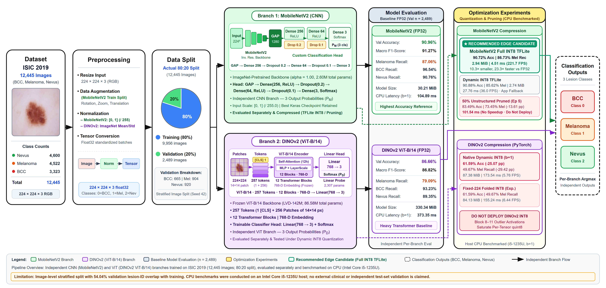

# DermaVision: ISIC 2019 Skin Lesion Classification, Model Optimization & Grad-CAM Explainability

<div align="left">
  
  
  
  
  
</div>

DermaVision is an end-to-end dermoscopic skin lesion classification project evaluated on a curated **3-class subset of ISIC 2019** (`BCC`, `Melanoma`, `Nevus`), combining two independent deep learning backbones (**MobileNetV2** and **DINOv2 ViT-B/14**), post-training **TFLite Dynamic-Range and Full Integer INT8 quantization**, **50% unstructured pruning**, **PyTorch Dynamic INT8 quantization diagnostics**, **MobileNetV2 Grad-CAM explainability**, and a **Streamlit screening interface**.

---

## Architecture Overview



*Current architecture diagram files: [`architecture_diagram_final.png`](architecture_diagram_final.png) and editable vector [`architecture_diagram_final.svg`](architecture_diagram_final.svg) (with prior revisions preserved in `architecture_diagram_revised.*`).*

DermaVision trains and evaluates **two separate, independent model branches** rather than a production weighted ensemble:

1. **CNN Branch — MobileNetV2 (`2,602,563` parameters, [`models/best_mobilenetv2.keras`](models/best_mobilenetv2.keras)):**
   - Backbone: ImageNet-pretrained `mobilenetv2_1.00_224` (`154` inner layers, final convolutional map `out_relu` of shape `7x7x1280`).
   - Classifier head: `GlobalAveragePooling2D -> Dense(256, ReLU) -> Dropout(0.2) -> Dense(64, ReLU) -> Dropout(0.1) -> Dense(3, Softmax)`.
   - Input preprocessing: `224x224` RGB scaled by `/ 255.0` to `[0, 1]`.

2. **Vision Transformer Branch — DINOv2 ViT-B/14 (`86,582,787` parameters, `dinov2_vitb14_pretrain.pth` + [`models/dinov2_100_epoch_best.pth`](models/dinov2_100_epoch_best.pth)):**
   - Backbone: Frozen DINOv2 `ViT-B/14` (`12` Transformer blocks, `12` attention heads, `257` tokens at `224x224`, `768`-dim `[CLS]` embedding).
   - Classifier head: `Linear(768 -> 3)` linear probe (Epoch `50/100`).
   - Input preprocessing: `224x224` RGB normalized with ImageNet `mean = [0.485, 0.456, 0.406]`, `std = [0.229, 0.224, 0.225]`.

*(Ensemble Audit Note: A post-hoc `0.5/0.5` probability blend scored `91.3620%` on the leaky `2,489`-image split vs `90.7593%` (`85.18%` Melanoma recall) for `0.4/0.6`, dropping to `87.15%` and `86.80%` on non-overlapping lesions. Weighted fusion is not used in the current pipeline.)*

---

## Dataset, Splits & Critical Research Limitations

- **Curated Dataset:** **12,445** dermoscopic images across **3 classes**:
  - `0: BCC` (Basal Cell Carcinoma) — `3,323` images (`2,658` train / `665` val)
  - `1: Melanoma` — `4,522` images (`3,618` train / `904` val)
  - `2: Nevus` — `4,600` images (`3,680` train / `920` val)
- **Primary Evaluated Partition:** Stratified **image-level 80:20 split** (`random_state=42`) yielding **9,956 training** and **2,489 validation** images.

> [!WARNING]
> **Lesion-ID Data Leakage & Benchmark Limitations ([`results/lesion_overlap_audit.txt`](results/lesion_overlap_audit.txt)):**
> - Because the legacy `12,445` split was stratified at the image level rather than grouped by patient/lesion, **`1,345 / 2,489` validation images (`54.04%`, `964` unique lesions)** also appear in training (`BCC: 85.11%`, `Melanoma: 79.31%`, `Nevus: 6.74%`), while `1,886` images (`15.15%`) lack `lesion_id`.
> - On the clean non-overlapping validation subset (`n = 1,144`), MobileNetV2 FP32 drops from `94.50%` (overlap) to **`86.80%`** (`+7.70 pp` inflation; Macro F1 `81.31%`), and DINOv2 FP32 drops from `88.92%` to **`84.00%`** (`+4.92 pp` inflation; Macro F1 `75.66%`).
> - Accordingly, the `2,489`-image results measure **relative compression and optimization trade-offs** on a leaky internal validation split—**no independent clinical test set generalization is claimed**.
> - Zero-leakage lesion-grouped `Revision V1` splits (`8,712` train / `1,875` val / `1,858` test, `0` group overlap) are prepared in [`data/splits/revision_v1/`](data/splits/revision_v1/) with Kaggle training scripts for future retraining.

---

## Seven-Model Consolidated Experimental Results

All seven models were evaluated identically on the **`n = 2,489` validation images** (`BCC=665`, `Melanoma=904`, `Nevus=920`). CPU latency benchmarks were executed on a **`12th Gen Intel Core i5-1235U`** Windows 11 host (`10` physical / `12` logical cores, `15.65 GB` RAM, CPU-only; `50` warm-up + `200` timed `batch=1` preloaded iterations via `time.perf_counter()`).

| # | Model Variant | Val Acc | Macro Prec. | Macro Recall | Macro F1 | BCC Recall | Melanoma Recall | Nevus Recall | Size on Disk (`MiB` / `MB`) | Paired Pure `batch=1` Latency & FPS | Verdict |
|---:|---|---:|---:|---:|---:|---:|---:|---:|---:|---|---|
| **1** | **MobileNetV2 FP32 Original** | **90.96%** | **91.11%** | **91.45%** | **91.27%** | **96.54%** | **87.06%** | 90.76% | `30.21 MiB` (`31.67 MB`) | `104.89 ± 9.95 ms` (`9.53 FPS`, Run B `ONEDNN=1`) | Best Classification Baseline |
| **2** | **MobileNetV2 Dynamic TFLite** | 90.88% | 91.09% | 91.36% | 91.20% | 96.39% | 85.62% | 92.07% | **`2.74 MiB`** (`2.88 MB`) | `27.76 ± 1.77 ms` (`36.02 FPS`, Run B) | Active App Default (`6.2x` slower than Full INT8) |
| **3** | **MobileNetV2 Full INT8 TFLite** | 90.72% | 90.99% | 91.07% | 91.03% | 94.74% | **86.73%** | 91.74% | `2.94 MiB` (`3.08 MB`) | **`4.51 ± 0.20 ms`** (**`221.66 FPS`**, Run B) | **RECOMMENDED Edge Winner** |
| **4** | **MobileNetV2 50% Pruned (Ep 5)** | 83.49% | 84.84% | 83.33% | 83.55% | 82.41% | 73.45% | **94.13%** | `30.21 MiB` raw (`5.73 MiB` gz) | `101.54 ± 3.44 ms` (`9.85 FPS`, Run B) | **Do Not Deploy** (`-13.61 pp` Mel recall) |
| **5** | **DINOv2 FP32 Original** | 86.66% | 86.60% | 87.22% | 86.82% | 93.23% | 79.09% | 89.35% | `330.34 MiB` (`346.39 MB`) | `373.35 ms` (`2.68 FPS`, P2 `1300 MHz`) / `235.09 ms` (P1) | Research Backbone Only |
| **6** | **DINOv2 Native Dynamic INT8 (`b=1`)** | 61.59% | 68.17% | 58.71% | 57.54% | 31.13% | 49.67% | 95.33% | `87.38 MiB` (`91.63 MB`) | `173.54 ± 27.55 ms` (`5.76 FPS`, P2 `1300 MHz`) | **Do Not Deploy** (Outlier Collapse) |
| **7** | **DINOv2 Folded-224 INT8 (Exp.)** | 61.59% | 68.17% | 58.71% | 57.54% | 31.13% | 49.67% | 95.33% | `84.13 MiB` (`88.21 MB`) | `155.24 ± 9.88 ms` (`6.44 FPS`, P2 `1300 MHz`) | **Do Not Deploy** (Experimental Ablation) |

**Benchmark Condition & `N/A` Notes:**
- Full precision values (`4` decimals), confusion matrices, earlier unoptimized MobileNetV2 timings (`08:18`, `TF_ENABLE_ONEDNN_OPTS=0`: FP32 `269.56 ms`, Dynamic `73.74 ms`, Full INT8 `16.35 ± 2.43 ms` / `61.17 FPS`), DINOv2 E2E JPEG-from-disk timings (FP32 `422.78 ms` P2 / `254.78 ms` P1; INT8 `176.61 ms` P2), cold/warm load latencies, and peak RSS memory (DINOv2: `1,493.33–1,628.85 MiB`) are recorded in:
  - [`results/final/final_model_comparison.csv`](results/final/final_model_comparison.csv)
  - [`results/final/final_model_comparison.json`](results/final/final_model_comparison.json)
  - [`results/final/final_model_comparison_report.md`](results/final/final_model_comparison_report.md)
- Metrics marked `N/A` in source CSV/JSON (MobileNetV2 peak RSS, load time, and E2E JPEG-from-disk latency; DINOv2 `gzip -9` sizes; TFLite/pruned ROC-AUC) were never instrumented in those runs and are intentionally not fabricated.

---

## Optimization Deep Dive: Quantization & Pruning

### 1. MobileNetV2 Post-Training Quantization ([`quantize_and_evaluate_int8.py`](quantize_and_evaluate_int8.py), [`results/int8/`](results/int8/mobilenetv2_int8_verification_report.md))
- **Full Integer INT8 (`TFLITE_BUILTINS_INT8`)** calibrated on `250` training images with `int8` input/output tensors (`in_scale = 1/255.0, Z_in = -128`; `out_scale = 1/256.0, Z_out = -128`) shrinks disk footprint by **`90.27%`** (`30.21 MiB -> 2.94 MiB`) and preserves clinical sensitivity: accuracy stays within **`-0.24 pp`** (`90.72% vs 90.96%`), Macro F1 within **`-0.24 pp`** (`91.03% vs 91.27%`), and Melanoma recall within **`-0.33 pp`** (`86.73% vs 87.06%`, outperforming Dynamic-Range TFLite's `85.62%` by `+1.11 pp`).
- Under XNNPACK CPU execution (`Audit Run B`, including numpy `int8` input quantization + output dequantization), Full INT8 reaches **`4.51 ms` (`221.66 FPS`)**, **`6.2x` faster** than Dynamic-Range TFLite (`27.76 ms`) and **`23.3x` faster** than FP32 Keras (`104.89 ms`).

### 2. DINOv2 Native Dynamic INT8 Audit ([`models/dinov2/dinov2_dynamic_int8_inference.py`](models/dinov2/dinov2_dynamic_int8_inference.py), [`results/dinov2/`](results/dinov2/dinov2_dynamic_int8_report.md))
- Applying PyTorch `quantize_dynamic({nn.Linear}, dtype=torch.qint8)` (`onednn` engine, `49/49` linear layers) shrinks total size by **`73.55%`** (`330.34 MiB -> 87.38 MiB`) and accelerates CPU inference `2.15x` (`373.35 -> 173.54 ms`), **but causes severe clinical sensitivity collapse**: accuracy drops **`-25.07 pp`** (`61.59%`) and Melanoma recall plunges **`-29.42 pp`** (`49.67%`, misclassifying `414 / 904 = 45.80%` of melanomas as benign `Nevus`). `batch=64` degrades further to `60.55%` (`48.12%` Melanoma recall).
- Layer-wise activation diagnostics prove register-free DINOv2 ViT-B/14 generates **extreme token outliers in Transformer Blocks 8–11** (`|x| <= 494.72` vs `p99 ≈ 1.3–2.7`), causing PyTorch's single per-tensor `quint8 [0, 255]` dynamic scale (`Δ ≈ 0.24–0.35`) to destroy `[CLS]` representation (`cosine similarity = 0.1469` at Block 11). Folding `pos_embed` (`257` tokens) improved latency (`155.24 ms`) but left logits identical (`61.59%`).

### 3. MobileNetV2 50% Unstructured Magnitude Pruning ([`prune_and_train_mobilenetv2.py`](prune_and_train_mobilenetv2.py), [`results/pruning/`](results/pruning/mobilenetv2_pruning_independent_audit.md))
- Pruning `50%` of `Conv2D`/`Dense` weights (`49.9971%` prunable sparsity, `47.45%` overall) over `5` epochs (`Adam 1e-5`, zero constant-sparsity recovery) dropped validation accuracy to **`83.49%` (`-7.47 pp`)** and Melanoma recall to **`73.45%` (`-13.61 pp`)**, more than doubling missed Melanomas (`78 -> 176`).
- Standard dense `.keras` storage stayed `30.21 MiB` (`5.73 MiB` only under `gzip -9`), and CPU inference showed zero dense speedup (`101.54 ms vs 104.89 ms`).

---

## Grad-CAM Explainability ([`gradcam.py`](gradcam.py), [`results/gradcam/`](results/gradcam/gradcam_generation_report.md))

Because `mobilenetv2_1.00_224` is nested as a `Functional` sub-model inside [`models/best_mobilenetv2.keras`](models/best_mobilenetv2.keras) and high-confidence (`~100%`) softmax probabilities suffer gradient saturation (`|∇_p| <= 1e-12`), [`gradcam.py`](gradcam.py) implements **two-stage nested replay** over target layer `mobilenetv2_1.00_224/out_relu` (`7x7x1280`) differentiating **pre-softmax logits (`y^c`)** (`replay_max_prob_diff = 0.0`, `Image.BICUBIC` upsampling, fixed `[0.0, 1.0]` Jet scale, `alpha = 0.40`). *(No DINOv2 Grad-CAM implementation is present.)*

Four verified validation cases with **strictly zero training lesion-ID overlap** (`n = 1,144` clean slice) are generated in [`results/gradcam/gradcam_comparison.png`](results/gradcam/gradcam_comparison.png) and [`results/gradcam/gradcam_results.csv`](results/gradcam/gradcam_results.csv):

| Case | Image ID (`Lesion ID`) | Ground Truth | FP32 Prediction (`best_mobilenetv2.keras`) | Full INT8 Check | Logit `y^c` / Mean Map | Observation |
|---|---|---|---|---|---|---|
| **1 (BCC TP)** | `ISIC_0073082.jpg` (`BCN_0002149`) | `BCC` | `BCC` (`100.00%`) | `BCC` (`100.00%`) | `17.90` / `0.398` | Peak activation highlights central BCC nodule |
| **2 (MEL TP)** | `ISIC_0033522.jpg` (`HAM_0004321`) | `Melanoma` | `Melanoma` (`100.00%`) | `Melanoma` (`100.00%`) | `14.67` / `0.402` | Peak activation tracks pigmented Melanoma core |
| **3 (NV TP)** | `ISIC_0026951.jpg` (`HAM_0003861`) | `Nevus` | `Nevus` (`100.00%`) | `Nevus` (`100.00%`) | `17.07` / `0.440` | Concentrates over Nevus body/upper margin |
| **4 (MEL->NV FN)** | `ISIC_0025313.jpg` (`HAM_0001378`) | `Melanoma` | **`Nevus` (`99.9999%`)** | `Nevus` (`100.00%`) | `8.99` / `0.304` | Attends directly to lesion yet misclassifies Melanoma |

> **Explainability Boundary:** Case 4 (`ISIC_0025313.jpg`) demonstrates that coarse `7x7` Grad-CAM localization inside the lesion boundary **does not prove clinical explainability, histopathological validity, or diagnostic correctness**.

---

## Deployment Recommendation & Runtime Alignment

- **Recommended Edge Deployment Candidate:** [`models/best_mobilenetv2_full_int8.tflite`](models/best_mobilenetv2_full_int8.tflite) (`2.94 MiB`, `90.72%` Val Acc, `86.73%` Melanoma recall, `4.51–16.35 ms` host CPU `batch=1`) via standalone inference module [`prediction_int8.py`](prediction_int8.py) (`MobileNetV2FullINT8Predictor`).
- **Current Web App State ([`streamlit_app.py`](streamlit_app.py)):** Currently loads [`models/best_mobilenetv2.tflite`](models/best_mobilenetv2.tflite) (Dynamic-Range, `2.74 MiB`, `27.76 ms`) via [`prediction.py`](prediction.py). Note that `streamlit_app.py` contains a legacy UI label citing `[-1, 1]` scaling even though `preprocessing.py` and `prediction_int8.py` both normalize pixels identically by `/ 255.0` to `[0, 1]`.
- **Hardware Caveat:** [`benchmark.py`](benchmark.py) targets Raspberry Pi / Linux ARM64 via `ai-edge-litert`, but **no physical Raspberry Pi benchmark results were executed or saved**; all timing claims in this repository reflect the `Intel Core i5-1235U` CPU host.

---

## Repository Structure

```text
Dermavision(ISIC2019 dataset)/
├── streamlit_app.py                        # Multi-page Streamlit UI dashboard
├── prediction.py / preprocessing.py        # Dynamic TFLite inference & /255.0 [0,1] preprocessing
├── prediction_int8.py                      # Standalone Full INT8 TFLite inference wrapper
├── gradcam.py                              # Fixed two-stage nested Grad-CAM utility
├── validator.py / utils.py / evaluation.py # Input sanity checks, class mapping & evaluation
├── test_pipeline.py / benchmark.py         # Smoke test & hardware benchmark utility
├── quantize_and_evaluate_int8.py           # MobileNetV2 Full INT8 quantization & benchmark
├── prune_and_train_mobilenetv2.py          # MobileNetV2 50% pruning training script
├── evaluate_pruned_mobilenetv2.py          # Pruned model evaluation & paired ONEDNN audit
├── train_mobilenetv2_revision_v1*.py       # Prepared Revision V1 grouped-split training scripts
├── train_dinov2_revision_v1.py             # Prepared Revision V1 DINOv2 grouped-split script
├── architecture_diagram_final.{png,svg}    # Current overall architecture diagram
├── models/
│   ├── class_names.json                    # {0: BCC, 1: Melanoma, 2: Nevus}
│   ├── best_mobilenetv2.keras              # Original FP32 MobileNetV2 baseline (30.21 MiB)
│   ├── best_mobilenetv2.tflite             # Dynamic-Range TFLite (2.74 MiB, app default)
│   ├── best_mobilenetv2_full_int8.tflite   # Full INT8 TFLite (2.94 MiB, recommended candidate)
│   ├── dinov2_100_epoch_best.pth           # DINOv2 Ep50 linear head (11.7 KB)
│   └── dinov2/dinov2_dynamic_int8_inference.py  # DINOv2 INT8 diagnostic inference module
├── data/splits/revision_v1/                # Prepared zero-leakage 70/15/15 split CSVs & summary
├── metrics/                                # Confusion matrices, ROC curves, prob arrays (.npy)
└── results/
    ├── final/                              # Consolidated 7-model CSV, JSON, Markdown & GitHub inventory
    ├── int8/                               # MobileNetV2 INT8 metrics & verification report
    ├── pruning/                            # Pruning history, metrics, report & independent audit
    ├── dinov2/                             # DINOv2 Phase 1 baseline & Phase 2 INT8 failure audits
    ├── gradcam/                            # Grad-CAM generator, CSV results, reports & sample PNGs
    └── revision_v1/                        # Leakage audit & Revision V1 pretraining diagnostics
```

---

## Setup, Verification & Usage

```bash
# 1. Clone repository
git clone https://github.com/d-chetan-kumar/dermaVision-Hardware-.git
cd "dermaVision-Hardware-"

# 2. Create virtual environment & install dependencies
python -m venv .venv
.venv\Scripts\activate          # Linux/macOS: source .venv/bin/activate
pip install -r requirements.txt

# 3. Verify core pipeline & standalone Full INT8 inference
python test_pipeline.py
python prediction_int8.py

# 4. Launch Streamlit application
streamlit run streamlit_app.py

# 5. Regenerate Grad-CAM figures (requires local ISIC 2019 image folder)
python results/gradcam/generate_gradcam.py
```

*(For lightweight Raspberry Pi / Streamlit runtime without retraining/PyTorch experiments, only `streamlit`, `numpy`, `pillow`, `fpdf2`, and `ai-edge-litert` on Linux alongside `models/best_mobilenetv2_full_int8.tflite` or `models/best_mobilenetv2.tflite` are required.)*

---

## Large Files, `.gitignore` & Git LFS Notes

- **Trackable Repository Size:** ~`70 MiB` total across tracked + staged source files, figures, metrics, and compact `.tflite`/`.keras` baselines; **`0` trackable repository files exceed `50 MB` or `100 MB`**.
- **Excluded Heavy Files (`> 50 MB` / `> 100 MB` via `.gitignore`):**
  - `ISIC_2019_Training_Input/` (`25,333` files, `9.801 GB`) + `ISIC_2019_*.csv` raw dataset tables.
  - External Torch Hub backbone `dinov2_vitb14_pretrain.pth` (`346.38 MB` / `330.33 MiB`, `> 100 MB`; stays in `~/.cache/torch/hub/checkpoints/`).
  - `results/pruning/checkpoints/*.h5` (`5` files totaling `209.05 MB` / `199.37 MiB`).
  - Rejected `models/dinov2/dinov2_vitb14_dynamic_int8.pth` (`91.63 MB` / `87.38 MiB`, `50–100 MB` warning tier).
  - Duplicate `.keras` copies (`best_mobilenetv2_pruned.keras`, `models/revision_v1/mobilenetv2/best_mobilenetv2.keras`, ~`31.67 MB` each), `.keras_cache/`, Kaggle zip packs, virtualenvs, caches, and secrets.
- **Git LFS Guidance:** If you ever choose to store `dinov2_vitb14_pretrain.pth` (`346.38 MB`, **`> 100 MB` GitHub hard limit**) or `models/dinov2/dinov2_vitb14_dynamic_int8.pth` (`91.63 MB`) inside Git rather than keeping them ignored/external, initialize Git LFS and track **exact file paths** rather than blanket `*.pth` (so the already-tracked `11.7 KB` linear heads stay in standard Git):
  ```bash
  git lfs install
  git lfs track "models/dinov2/dinov2_vitb14_dynamic_int8.pth"
  ```
- See [`results/final/github_file_inventory.md`](results/final/github_file_inventory.md) for the complete file-by-file inventory and safety verification.

---

## Medical Disclaimer

> **DISCLAIMER:** DermaVision is an artificial intelligence research and educational prototype evaluated on a curated ISIC 2019 subset. It is **NOT** clinically validated, approved as a medical device, or safe to replace dermoscopic examination or biopsy by a board-certified dermatologist.
